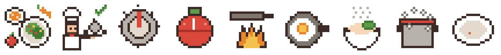
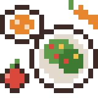
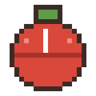

# Pixel Icons: Ideas and Drafts

The app should use its own pixel art, never emoji. An emoji looks different on every phone and computer and
says "generic". Each icon here is a small scene from the kitchen, drawn for this app, so it carries the
EverFlavor world into the smallest corners of the page.

All icons are 20 x 20 pixels, shown at 2x in the app (40 x 40) so every pixel stays sharp. They are drawn in
code in [pixel-art/make_pixel_art.py](pixel-art/make_pixel_art.py) (`ICONS`), so changing one means editing a
few lines and running the script again.

**Status:** drafts, already in the concept app. Every one is open to change; comments welcome.

## Rules for every icon

1. **A real object from a kitchen, never a symbol.** A tomato timer, not a clock; an oven knob, not a gear.
2. **Readable at 20 x 20.** At most three objects, a dark outline (`#3B2A25`) around each, one highlight.
3. **The same light and outline as the kitchen scene**, so icons and background look like one world.
4. **Color means something.** Green is safe, red is a warning, steel grey is a tool. Never color alone: each
   state also has its own shape (a steaming bowl, a pot boiling over, an empty plate).
5. **Every icon has a text label next to it or an `aria-label`**, for screen readers and for anyone who reads
   the picture differently.

## The drafts

### Find recipes: the spread

A table seen from above: a bowl of soup, a salad plate with cherry tomatoes and corn, a whole tomato and a
carrot. "Here is a table full of ideas."

- **Other ideas:** a recipe book open on a cutting board; a fork and a magnifying glass made of a ladle.
- **To decide:** does the top-down view read well next to the side view of "Check my recipe"?

### Check my recipe: the chef hands it over

The chef holds out a covered plate (a cloche), with a green check rising from it. "Hand me your recipe,
I'll check it." It repeats the chef guide from the page, so the user learns who is checking.

- **Other ideas:** the chef tasting from a spoon; a recipe card under a magnifying glass; a plate on a scale.
- **To decide:** the check mark is the only "symbol" here. Keep it, or let a sparkle say "approved" instead?

### Settings: the oven knob

Turning a knob is how a kitchen changes its settings. The red pointer could turn when the theme changes.

### Recipe stats: flame, egg, tomato timer

| Calories | Protein | Minutes |
|---|---|---|
|  |  |  |
| A stove flame under a pan: energy, the heat that cooks | A fried egg in a pan: the protein everyone knows | A tomato kitchen timer, the classic one |

These replace the three number boxes on each recipe card with one row of icon, number and unit.

- **To decide:** for vegan users, should protein show a bean or tofu instead of the egg? (The icon could
  follow the profile.)

### Results: what the chef shows in the speech bubble

| Safe | Problem found | Nothing matched |
|---|---|---|
|  |  |  |
| A steaming bowl with a basil leaf: ready to eat | A pot boiling over: something needs attention | An empty plate with crumbs: try a looser search |

Each state has its own shape as well as its own color, so it still reads without color.

## Next icons to draw

Not drafted yet; ideas for discussion.

| Where | Idea |
|---|---|
| Sidebar, "Your profile" | An apron on a hook, with the user's name tag |
| "I can't eat" | A plate with a lid locked by a ribbon (no emoji crossed-out symbols) |
| "I follow" (diets) | A small recipe book with a bookmark |
| Allergens on cards | One tiny food each: peanut, milk bottle, egg, wheat stalk, fish, shrimp, sesame seeds |
| Cuisine menu | A plate that changes with the cuisine: noodles, tacos, curry, pasta, a baguette |
| Loading ("Checking...") | The pot's steam animated in three frames, instead of a spinning circle |
| Local AI on or off | The chef's hat lit or dimmed |
| Achievements (later) | Medals shaped like a whisk, a ladle and a golden pan |

## Animation ideas (later)

- The steam over the soup bowl rises in 2-3 frames.
- The oven knob turns when the theme changes.
- The chef blinks every few seconds, and nods when a recipe is safe.
- Animation stays off when the user's computer asks for reduced motion.
