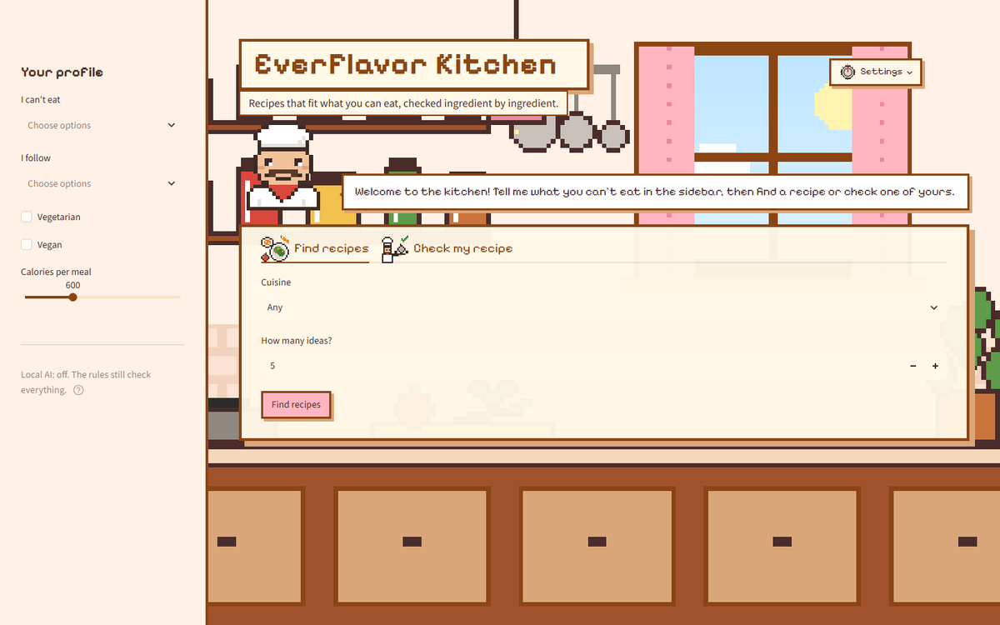
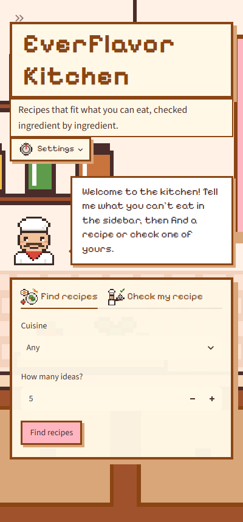

# EverFlavor Kitchen: Front-End Plan

How to take the concept from "looks fun" to a site people find, trust and come back to. For the team to read,
argue with and split up. Branch: `concept/pixel-kitchen-ui`.

| Desktop | Phone |
|---|---|
|  |  |

## Where we are

Done on the branch:

- The kitchen shows: the title hangs on a wooden sign, the chef stands in front of the shelves, and only the
  tools sit on a panel over the counter.
- Settings moved to the top right (a pixel button with the oven knob); four themes, Classic is Eva's palette.
- Pixel icons instead of emoji ([ICONS.md](ICONS.md)); the chef reads out every result.
- The color bug is fixed: checked with a browser set to dark mode, the page keeps its colors.

## Who it is for

People who have to read every label before they eat:

- **Allergies:** someone who must avoid peanuts, shellfish or sesame, or a parent cooking for a child who must.
- **Religious and ethical diets:** halal, kosher, Jain, vegetarian, vegan.
- **Health goals:** a calorie budget per meal, more protein, conditions like gout (screens, not medical advice).

What they want is **confidence**: "I can cook this and nobody gets sick." What makes EverFlavor different is
that it catches what people miss: satay sauce has peanuts, Worcestershire sauce has fish, "panceta" is pork.
The page should show that within the first seconds.

## What brings people in and keeps them

Ranked by impact for the effort.

### 1. Show the value in five seconds

- **A promise people get at once**, on the sign: "Recipes that fit what you can eat, checked ingredient by
  ingredient" (done).
- **The hook, live:** the chef opens with a real catch, for example "Did you know satay sauce has peanuts?
  Paste any recipe and I'll check it." People share surprising facts.
- **Something to look at right away:** three "Today's safe picks" with photos on the first screen, before
  anyone fills a form. An empty page loses people.

### 2. Onboarding in the kitchen, not in a form

- The chef asks **three quick questions**, one card at a time: what can't you eat, which diet, how many
  calories per meal. Each answer is a big pixel button (peanut, milk, egg, wheat...), not a dropdown.
- The answers become **chips at the top of the page** ("Avoiding: peanut, dairy · Halal · 600 kcal") that
  can be tapped to change. The sidebar becomes optional.
- **This also fixes phones:** on a phone the sidebar is hidden, so today a phone user never sees the profile.

### 3. Recipe cards that make people want to cook

- A big photo, the cuisine, and the three pixel stats (calories, protein, minutes).
- **"Why it's safe for you"**: one line from the back end, for example "No peanuts, no pork, halal-friendly
  ingredients." That line is the product; show it on every card.
- Open a card for the steps; **save** it to "My cookbook" (this session for now; saved profiles later, encrypted,
  per the privacy rules in `docs/ethics_privacy.md`); **share** a link to it.

### 4. Delight, in small doses

- Steam rising from the pot, the chef blinking and nodding at a safe recipe, the oven knob turning on a theme change.
- An **Auto** theme that follows the clock: Morning before 11, Classic by day, Night after dark.
- Small kitchen achievements: first safe recipe, five cuisines tried, a week of meals planned.
- All motion off when the computer asks for reduced motion; sound, if ever, off by default.

### 5. Trust

- A **"How we check"** page: the 44 rules, hidden allergens, disguised and foreign words, what the checks
  cannot do ("not medical advice; check the label"), and the data sources.
- Diet labels always say "halal-friendly ingredients", never "halal" (project policy).
- Nothing about the user is stored or sent anywhere; say so on the page.

### 6. Speed

- Today the first load reads about 290,000 recipes (`Running load_recipes()` shows for several seconds).
  Load a small index first, show the kitchen and the chef at once ("Warming up the oven..."), and load the
  rest behind them.
- Keep the art small (the whole kitchen is a 240 x 135 PNG, under 10 KB).

### 7. Phones first

- Many visitors arrive from a shared link on a phone. Test every change at 400 pixels wide: chips instead of
  the sidebar, the chef smaller, the tabs fitting on one line (done), cards in one column.

### 8. Accessibility

- Check the contrast of every theme (text on panel, text on buttons, chips).
- The pixel font only for headings, labels and the chef's short lines; body text in a plain font.
- Every icon has a text label or an alt text; visible keyboard focus.

### 9. Getting found

- **Host it:** Streamlit Community Cloud or Hugging Face Spaces (free; the demo data is ready for it).
- **A one-page landing site** (GitHub Pages): the pixel kitchen, a 20-second GIF of the chef catching a hidden
  allergen, three screenshots, and a "Try it" button. A Streamlit app is hard for search engines to read; a
  plain page is easy.
- **A social preview image** (the kitchen with the sign), so a shared link shows a picture instead of a gray box.
- Before going public: confirm the license of the demo data's food photos (see `pixel-art/references/SOURCES.md`).

### 10. Learn what works, privately

- Count only what helps decide: which tab people use, how often a search finds nothing, which theme they pick.
  Never the user's words, allergies or recipes (project rule). The "nothing found" count shows which
  filters are too strict.

## A better kitchen (the background)

The current scene is a first sketch. To make it feel like a real kitchen:

1. **Design the scene around the page.** Leave a clear wall where the sign hangs; put the counter line where the
   tools panel ends; place the chef behind the counter instead of in front of the shelves.
2. **Real proportions and real objects.** A counter about waist high; upper cabinets above it; the window over
   the sink (not over the stove); a fridge, an oven with a glass door, a tap, a knife block, a spice rack,
   hanging herbs and a utensil jar.
3. **One light source.** Daylight from the window (Classic, Morning, Basil) or the lamp (Night), with matching
   highlights and soft shadows under every object.
4. **Texture with few pixels.** Wood grain lines, tile grout, a highlight on steel, dithering instead of smooth gradients.
5. **Twice the resolution** (480 x 270): room for that detail, still chunky when scaled up.
6. **Layers.** Wall, counter and foreground as separate images, so they can move a little apart when the page
   scrolls (parallax) and the steam and curtains can animate.
7. **A phone version of the scene,** taller than wide, so the window and the chef still show on a phone.

## What Streamlit can and cannot do

Streamlit is right for the class project: the back end is Python, and the page is a few hundred lines.
It reruns the whole page on every click and controls most of the layout, so some ideas above need workarounds
(onboarding cards with `st.session_state`, animations in CSS). If the team later wants full control (smooth
animations, drag and drop, offline use), the next step is a custom Streamlit component for the chef, or a
separate JavaScript front end (React) calling the same `src/everflavor` code through a small API. Keeping
every decision in the back end, as now, makes that move easy.

## Roadmap

| When | What |
|---|---|
| **Done** | Kitchen visible, settings on top, pixel icons, themes, color fix |
| **Next** | Profile chips at the top and the chef's three-question onboarding; "Why it's safe" line on cards; Today's safe picks; faster first load |
| **Then** | Redrawn kitchen (480 x 270, real objects, one light, layers); animated steam and chef; Auto theme; "How we check" page |
| **Later** | Hosting, landing page and preview image; My cookbook and sharing; chef chat with the local AI; meal planner |

## Questions for the team

1. Do we keep the sidebar on desktop, or move the profile to chips at the top everywhere?
2. Which three foods open the onboarding as big buttons? (Most common US allergens: milk, egg, peanut, tree
   nut, fish, shellfish, wheat, soy, sesame.)
3. Who redraws the kitchen: one person by hand (Aseprite or Piskel), or keep it drawn in code?
4. Where do we host the demo, and do we want the landing page before the final presentation?
