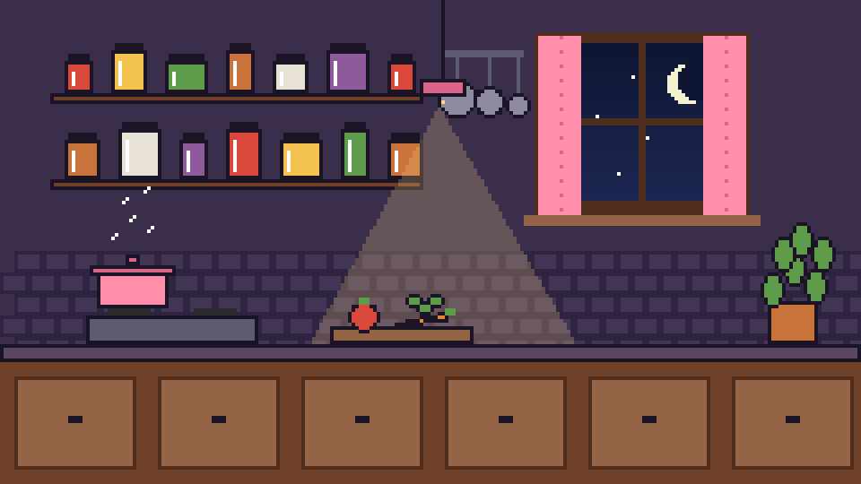
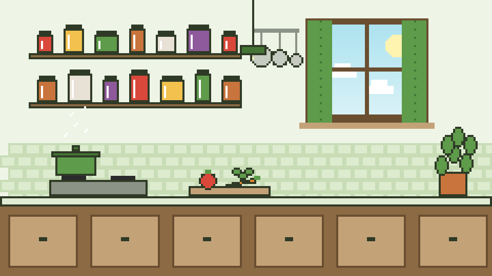

# EverFlavor Kitchen: Design Concept

A concept for the app's look, for the team to try and discuss (branch `concept/pixel-kitchen-ui`).
It keeps Eva's cooking-game colors and everything the page already does, and adds a world around it.


## The idea

- **A pixel-art kitchen behind the page.** Shelves of jars, hanging pans, a window, a steaming pot, a cutting
  board and a plant. The page sits on a panel over it, like a recipe card pinned to the kitchen wall.
- **A pixel chef who guides the user.** The chef greets people and reads out what happened: how many recipes
  were found, or which line of a recipe breaks their profile. The chef only repeats the back end's answer and
  never decides anything (the app's golden rule: safety decisions come from `src/everflavor`).
- **Real food in the recipe cards.** When a recipe has a photo (the demo data has one for 99% of recipes),
  the card shows it in a pixel frame. The pixel art is the setting; the food is real.
- **Color themes in Settings** (bottom of the sidebar). The kitchen changes with the theme:

| Theme | Feel | Kitchen |
|---|---|---|
| **Classic** (default) | Eva's cream, brown and pink | Daytime, blue sky and clouds |
| **Morning** | Butter and peach | Sunrise in the window |
| **Night** | Plum and lamplight, easy on the eyes in the dark | Moon and stars, a lamp lighting the counter |
| **Basil** | Fresh greens | Daytime, green accents |

| Classic | Morning |
|---|---|
|  |  |
| **Night** | **Basil** |
|  |  |

The chef has three moods: happy (greeting, safe recipe), alert (a problem found) and thinking (nothing matched).

| Happy | Alert | Thinking |
|---|---|---|
|  |  |  |

## The color bug, fixed

On some computers the page showed white text on the cream background. The page paints its own colors,
but Streamlit also follows each computer's light or dark mode, so a computer in dark mode drew white text
and dark widgets over the cream. Two fixes: `.streamlit/config.toml` fixes Streamlit's own theme to light,
and every text color on the page now comes from the chosen theme. Text boxes and menus stay light with
dark text in every theme, so they are always readable.

## Try it

```bash
git checkout concept/pixel-kitchen-ui
python -m streamlit run app/app.py
```

Then open **⚙ Settings** at the bottom of the sidebar to switch themes. With a peanut allergy selected,
check the sample "Thai Peanut Bowl" to see the chef's warning.

## Changing the art

All the art is drawn from code in [pixel-art/make_pixel_art.py](pixel-art/make_pixel_art.py): the kitchen
from shapes, the chef from a 24 x 24 grid of letters (one letter per pixel color). Change a palette in
`THEMES` or a row of the chef, then run:

```bash
python design/pixel-art/make_pixel_art.py
```

It writes the small PNGs the app uses to `pixel-art/concept/` and 4x/8x previews to
`pixel-art/concept/preview/`. A new theme needs a palette there and a matching entry in `THEMES` in
`app/app.py`. Hand-drawn art (Aseprite, Piskel, LibreSprite) can replace any file with the same name and size.

## Ideas for later

Ranked, for when the team agrees on the direction:

1. **Chef chat tab:** talk to the chef (the local AI agent, `llm.ask_agent`), every answer screened.
2. **"Plan my meal" button:** the CrewAI meal planner (`crew.plan_meal`) cooks a recipe, the chef presents it.
3. **Animated details:** steam rising from the pot, the chef blinking, the window changing with the real time of day.
4. **Allergen icons:** small pixel icons (peanut, milk, egg, wheat, fish, shrimp) on recipe cards.
5. **Kitchen achievements:** first safe recipe, ten cuisines tried, a week of meals planned.

## References

See [pixel-art/references/SOURCES.md](pixel-art/references/SOURCES.md) for the inspirations, palettes, fonts and
where free photos can come from, with their licenses.
