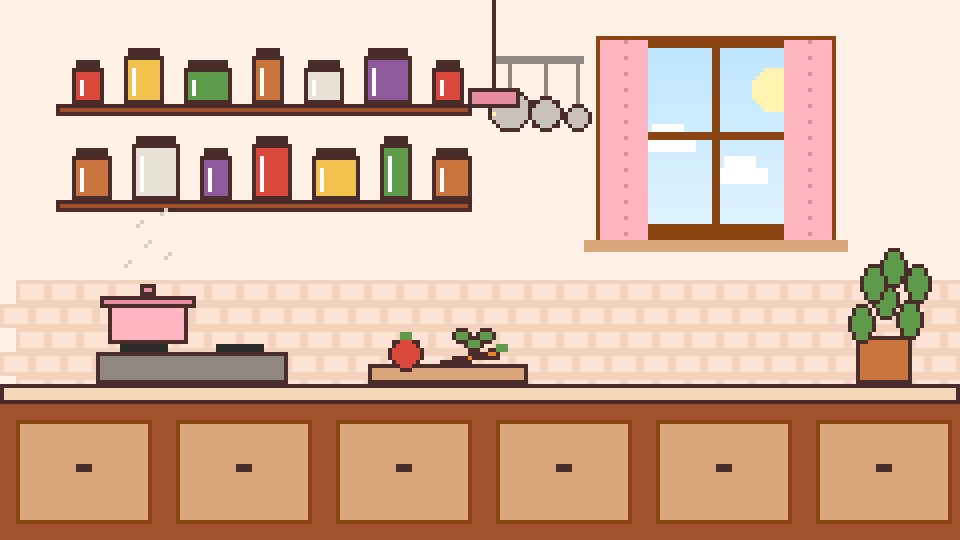
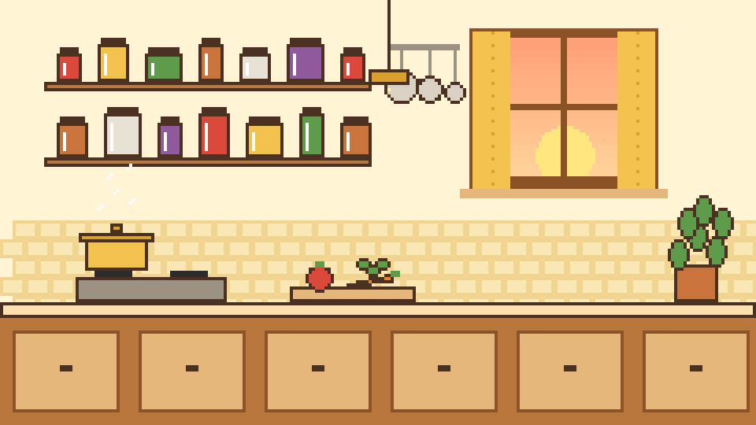

# EverFlavor Kitchen: Design Concept

A concept for the app's look, for the team to try and discuss (branch `concept/pixel-kitchen-ui`).
It keeps Eva's cooking-game colors and everything the page already does, and adds a world around it.



**Where it goes next:** [PLAN.md](PLAN.md), the front-end plan (who it is for, what brings people in, a better
kitchen, roadmap, questions for the team).

## Folders

| Folder | What is in it |
|---|---|
| [pixel-art/assets/](pixel-art/assets/) | The art the app uses: kitchens, chefs, icons and the interactive scene files |
| [pixel-art/previews/](pixel-art/previews/) | The same art enlarged, for looking at (and for these docs) |
| [pixel-art/drafts/](pixel-art/drafts/) | Concept work not final yet: [cuisine kitchens](pixel-art/drafts/cuisine-kitchens/README.md) |
| [pixel-art/archive/](pixel-art/archive/README.md) | Old versions, kept before any art is redrawn |
| [pixel-art/references/](pixel-art/references/SOURCES.md) | Inspirations, palettes, fonts, free art and photo sources, with licenses |
| [screenshots/](screenshots/) | The app on desktop and phone |

All the art is drawn by [pixel-art/make_pixel_art.py](pixel-art/make_pixel_art.py) (and
[cuisine_kitchens.py](pixel-art/cuisine_kitchens.py) for the four cuisine kitchens). Plans: [PLAN.md](PLAN.md);
icons: [ICONS.md](ICONS.md).

## The idea

- **A pixel-art kitchen behind the page.** Shelves of jars, hanging pans, a window, a steaming pot, a cutting
  board and a plant. The page sits on a panel over it, like a recipe card pinned to the kitchen wall.
- **A pixel chef who guides the user.** The chef greets people and reads out what happened: how many recipes
  were found, or which line of a recipe breaks their profile. The chef only repeats the back end's answer and
  never decides anything (the app's golden rule: safety decisions come from `src/everflavor`).
- **Real food in the recipe cards.** When a recipe has a photo (the demo data has one for 99% of recipes),
  the card shows it in a pixel frame. The pixel art is the setting; the food is real.
- **Color themes in Settings** (top right). The kitchen changes with the theme:

| Theme | Feel | Kitchen |
|---|---|---|
| **Classic** (default) | Eva's cream, brown and pink | Daytime, blue sky and clouds |
| **Morning** | Butter and peach | Sunrise in the window |
| **Night** | Plum and lamplight, easy on the eyes in the dark | Moon and stars, a lamp lighting the counter |
| **Basil** | Fresh greens | Daytime, green accents |

| Classic | Morning |
|---|---|
|  |  |
| **Night** | **Basil** |
|  |  |

**Cuisine kitchens (draft):** Japanese, Mediterranean, Mexican and Middle Eastern, each with its own chef. With
**Match the kitchen to the cuisine** on (Settings), searching a cuisine family opens its kitchen. Details and
what still needs redrawing: [pixel-art/drafts/cuisine-kitchens/](pixel-art/drafts/cuisine-kitchens/README.md).

The chef has three moods: happy (greeting, safe recipe), alert (a problem found) and thinking (nothing matched).

| Happy | Alert | Thinking |
|---|---|---|
|  |  |  |

## The color bug, fixed

On some computers the page showed white text on the cream background. The page paints its own colors,
but Streamlit also follows each computer's light or dark mode, so a computer in dark mode drew white text
and dark widgets over the cream. Two fixes: `.streamlit/config.toml` fixes Streamlit's own theme to light,
and every text color on the page now comes from the chosen theme. Text boxes and menus stay light with
dark text in every theme, so they are always readable.

## Try it

```bash
git checkout concept/pixel-kitchen-ui
python -m streamlit run app/app.py
```

Then open **Settings** at the top right to switch themes. With a peanut allergy selected,
check the sample "Thai Peanut Bowl" to see the chef's warning.

## Changing the art

All the art is drawn from code in [pixel-art/make_pixel_art.py](pixel-art/make_pixel_art.py): the kitchen
from shapes, the chef from a 24 x 24 grid of letters (one letter per pixel color). Change a palette in
`THEMES` or a row of the chef, then run:

```bash
python design/pixel-art/make_pixel_art.py
```

It writes the small PNGs the app uses to `pixel-art/assets/` and 4x/8x previews to
`pixel-art/previews/`. A new theme needs a palette there and a matching entry in `THEMES` in
`app/app.py`. Hand-drawn art (Aseprite, Piskel, LibreSprite) can replace any file with the same name and size.

## Ideas for later

Ranked, for when the team agrees on the direction:

1. **Chef chat tab:** talk to the chef (the local AI agent, `llm.ask_agent`), every answer screened.
2. **"Plan my meal" button:** the CrewAI meal planner (`crew.plan_meal`) cooks a recipe, the chef presents it.
3. **Animated details:** steam rising from the pot, the chef blinking, the window changing with the real time of day.
4. **Allergen icons:** small pixel icons (peanut, milk, egg, wheat, fish, shrimp) on recipe cards.
5. **Kitchen achievements:** first safe recipe, ten cuisines tried, a week of meals planned.

## Easter eggs: a kitchen you can touch

The kitchen behind the page is live (`app/kitchen_scene.html`, drawn from the pieces in
`pixel-art/assets/scene_<theme>.json`). Taps on empty parts of the page reach it:

| Tap | What happens |
|---|---|
| The curtains | They close across the window; tap again to open them |
| A jar, the tomato, the herbs, the plant | It shakes |
| The pans or the lamp | They swing |
| The pot or its lid | The lid hops and a puff of steam rises |
| The chef | The chef hops and winks |
| A tab icon, a recipe stat, the bubble's icon | It wiggles; the Settings knob turns on hover |

Scrolling over the kitchen still scrolls the page, and all motion stops when the computer asks for reduced
motion. More ideas: the lamp switching the Night light on and off, a cat walking along the counter after ten taps.

## Fonts

Two pixel fonts that read like normal text: **Jersey 10** for titles, tabs, buttons and numbers, and **VT323**
for the chef's lines and small labels (both Google Fonts, SIL Open Font License). The first font tried,
Pixelify Sans, drew B like G, C like O and 5 like S.

## Footer

The bottom of the page has the disclaimer (not medical advice, diet labels are not certifications, some
numbers are estimates, nothing is saved) and links to the contributors' GitHub accounts, the project and its license.

## Icons

The app uses its own pixel icons instead of emoji: on the tabs, the Settings knob, the recipe stats and the
chef's speech bubble. Ideas, drafts and open questions: [ICONS.md](ICONS.md).

## References

See [pixel-art/references/SOURCES.md](pixel-art/references/SOURCES.md) for the inspirations, palettes, fonts and
where free photos can come from, with their licenses.
