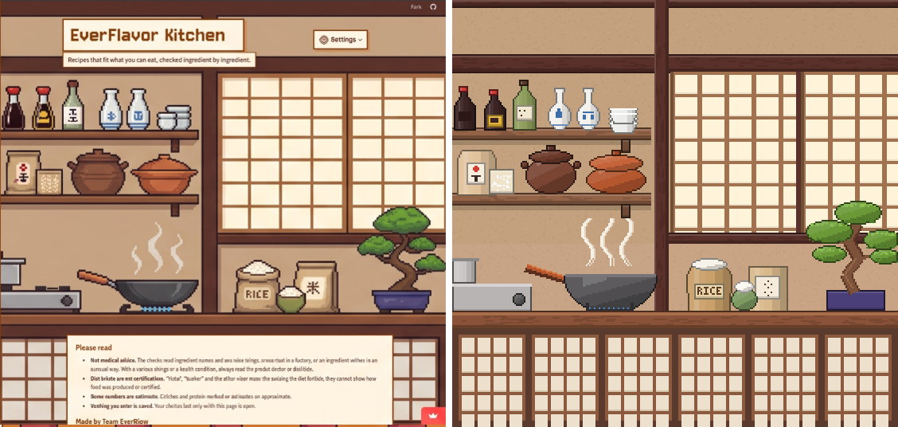
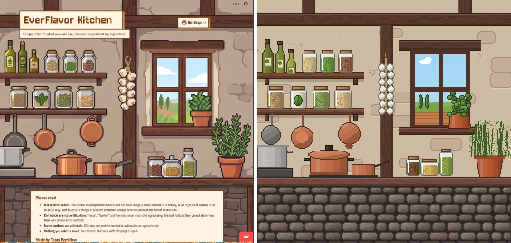
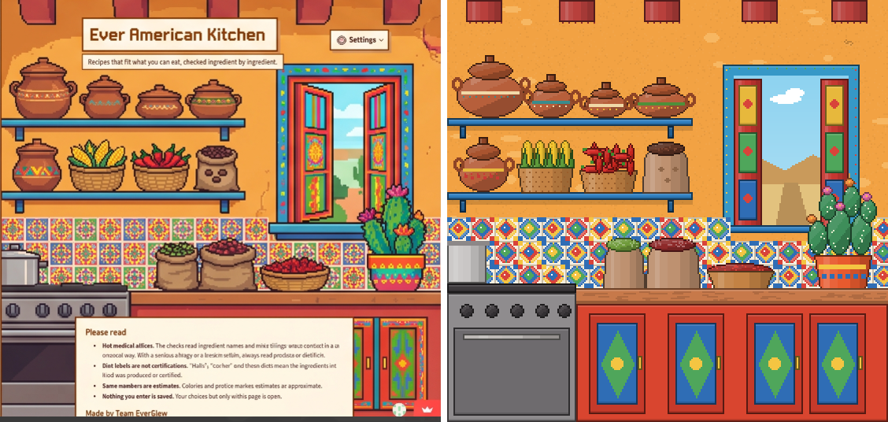
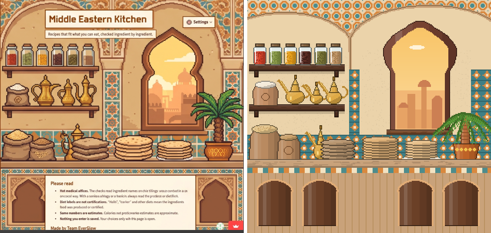
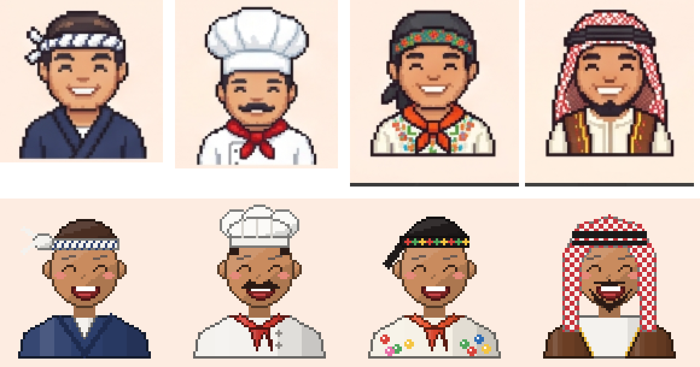

# Draft: The Concept Sheet, Recreated in Code

The team's concept kitchens and chefs (2026-10-18), redrawn in code as close to 1:1 as code allows, each on its
own and without interactive pieces yet. Drawn by [concept_recreation.py](concept_recreation.py):

```bash
python design/pixel-art/concept_recreation.py
```

How: every object's position was measured on the concept sheet and its colors read from it; every shape gets
pixel-art shading (light from the top left, a dark outline, highlights), wood gets grain, plaster gets speckles and
cracks, glass gets a highlight, tiles get their painted patterns. Kitchens are 280 x 268 art pixels (the concept's
proportions), chefs 64 x 64 on a transparent background; `_x4` files are 4x previews.

Each comparison shows the concept on the left and the recreation on the right.

## Kitchens









## Chefs

Top: the concept. Bottom: the recreation.



## Where it still differs

- **Fine detail:** the concept has more colors per object (painted patterns on every pot, tile and cloth) and
  smoother curves; code at this size can only suggest some of them.
- **Lighting:** the concept has soft, warm light and shadows across whole areas; here each object is shaded on its
  own.
- **Faces:** the chefs share one face; the concept's faces differ slightly (jaw, smile, eyebrows).
- **Wording:** the concept's titles (Ever American Kitchen, Middle Eastern Kitchen) are not drawn; the page writes
  "EverFlavor Kitchen" over every kitchen.

Not in the app yet; the code-drawn kitchens and the team's originals folder stay as they were.

**Pruned 2026-10-26:** kept `compare_mexican.png` and `compare_chefs.png`; the other images of this round were deleted and are in the git history.
