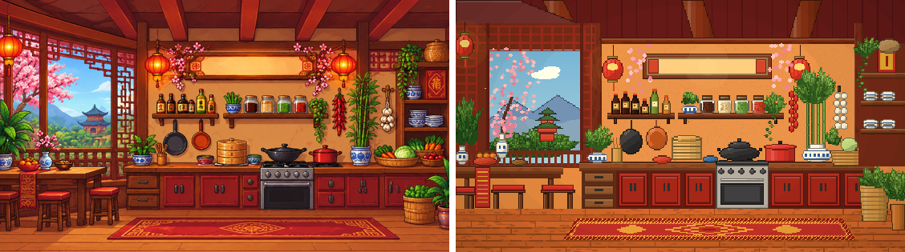
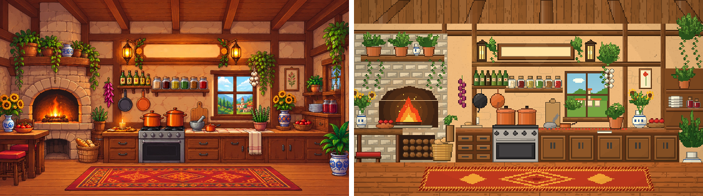
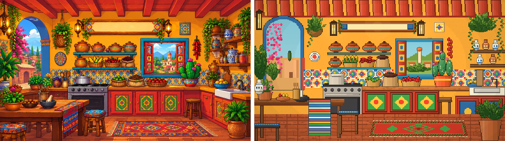
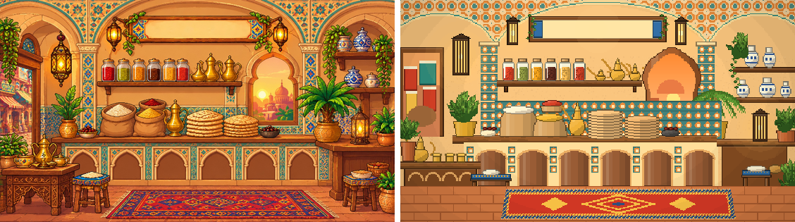

# Draft: The Four Concept Kitchens, Recreated in Code

The team's full kitchens ([references/concepts/](../../references/concepts/README.md)) redrawn in code, as close to
1:1 as code allows, each on its own and without interactive pieces yet. Drawn by
[concept_kitchens.py](concept_kitchens.py):

```bash
python design/pixel-art/concept_kitchens.py
```

How: every object's position was measured on the originals (at a quarter of their size, so 418 x 235 art pixels,
16:9 like the originals), colours read from them; every shape gets pixel-art shading; a finishing pass adds the warm
light and the darker edges of the originals. The sign is drawn **empty**: the app writes "EverFlavor Kitchen" on its
own, so the title stays visible when a phone crops the picture.

Each comparison shows the original (text painted out) on the left and the recreation on the right.









## Where it still differs

- **Detail and texture:** the originals have several colours on every object (painted pottery, carved wood, glazed
  tiles, leaves with veins); the recreations suggest them with a few.
- **Light:** the originals have glowing lamps and soft shadows; the recreations have one finishing pass.
- **Views:** the bazaar street, the village and the hill town outside the windows are simplified.
- **Shapes:** the Middle Eastern window is rounder than the original's pointed onion arch; the Mexican ceiling
  beams are straighter.

The previous drafts (the concept sheet's kitchens, 280 x 268) are in [../concept-recreation/](../concept-recreation/README.md).

**Pruned 2026-10-26:** kept `compare_mexican.png`; the other images of this round were deleted and are in the git history.
