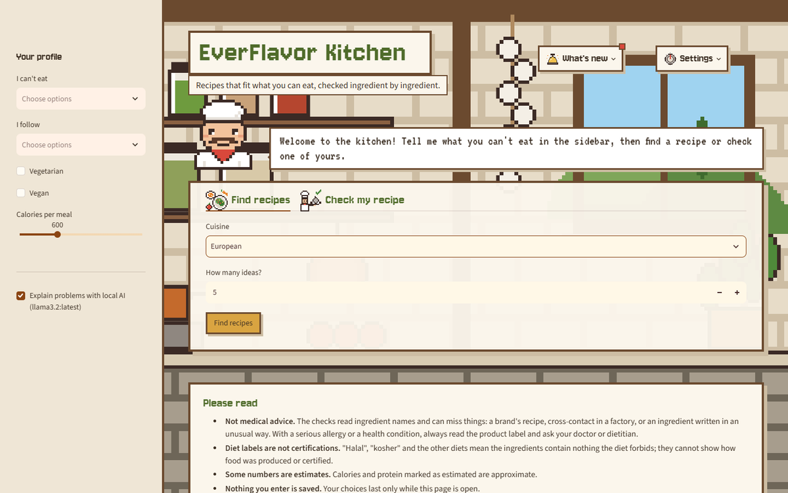
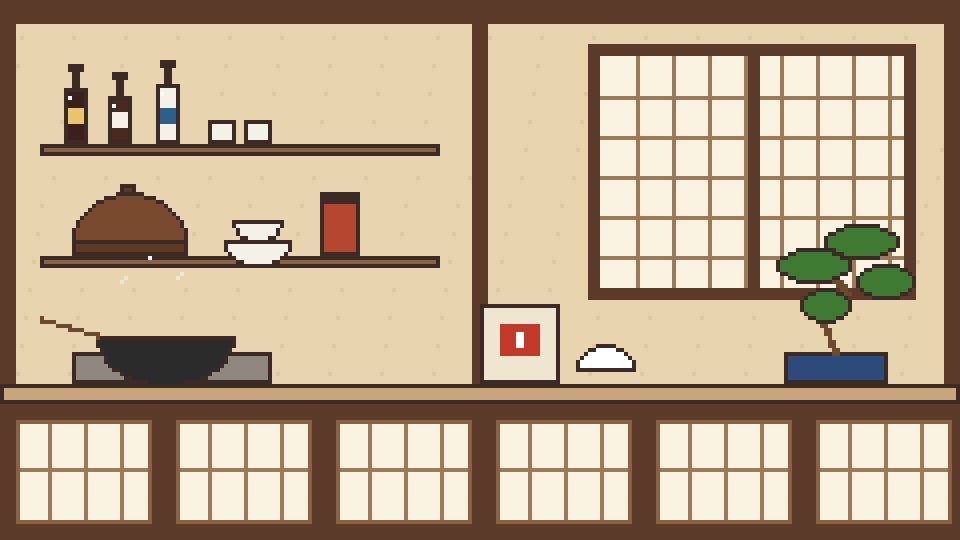
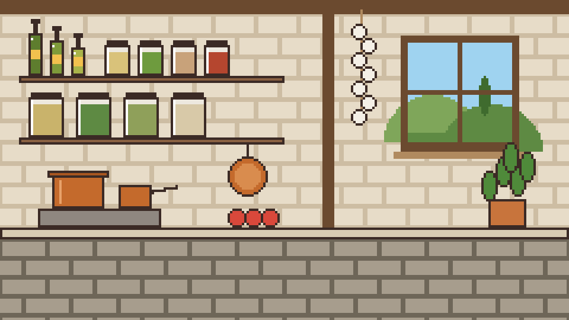
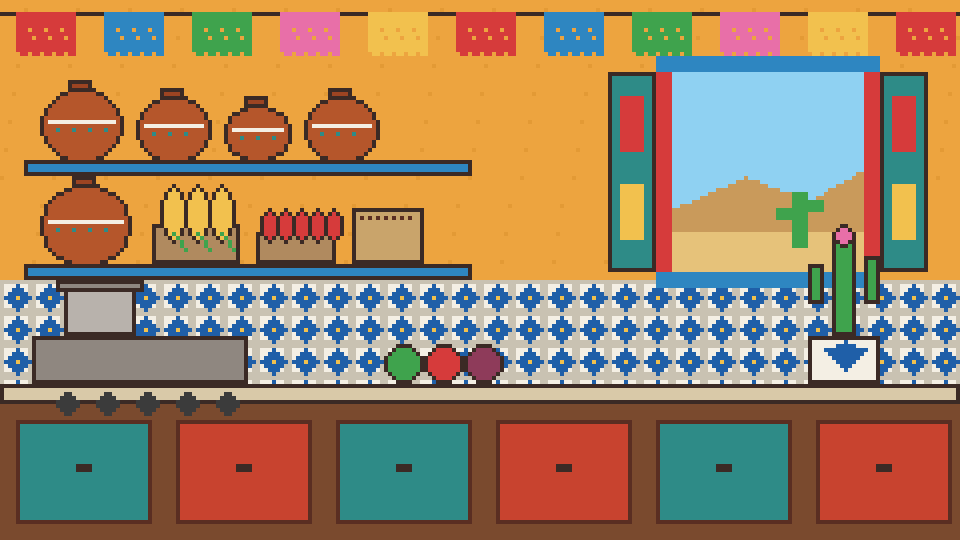
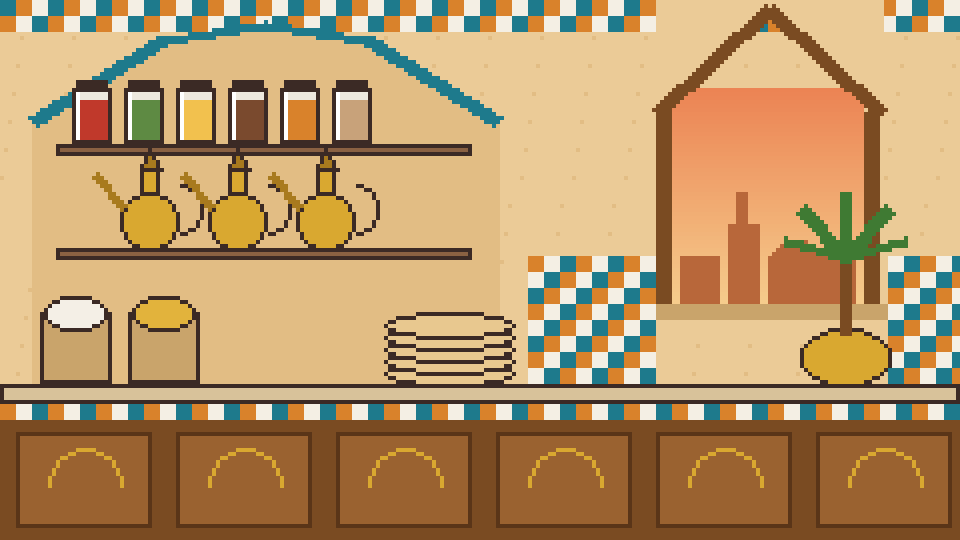

# Draft: Cuisine Kitchens

Four kitchens recreated from the team's concept art (2026-10-18), one for each cuisine family in the recipe
data. Drawn in code in [../../cuisine_kitchens.py](../../cuisine_kitchens.py), so anyone can change a color or move
a jar and redraw with `python design/pixel-art/make_pixel_art.py`.

**Title:** every kitchen keeps the app's own name, **EverFlavor Kitchen**. The concepts used other names
(The Jade Wok, The Golden Hearth, The Joyful Kitchen, The Saffron Market, Ever American Kitchen), which would make
the app look like four different products.

| Kitchen | Cuisine family | From the concept | Chef |
|---|---|---|---|
| Japanese | Asian | Wood beams, shoji window, soy and sake bottles, donabe pot, rice sack, wok, bonsai | Hachimaki headband, navy samue jacket |
| Mediterranean | European | Stone walls, olive oil and spice jars, garlic braid, copper pans, window on green hills, basil | The classic toque and red neckerchief |
| Mexican | Latin American | Papel picado, clay ollas on blue shelves, corn, chilies, beans, talavera tiles, painted window with cactus | Red bandana, embroidered shirt |
| Middle Eastern | Middle Eastern | Tiled arches, spice jars, brass dallah coffee pots, grain sacks, flatbread, arched window at sunset, palm | Keffiyeh with agal, white thobe |

| Japanese | Mediterranean |
|---|---|
|  |  |
| **Mexican** | **Middle Eastern** |
|  |  |

The scenes on their own (before the page is drawn over them):

| Japanese | Mediterranean | Mexican | Middle Eastern |
|---|---|---|---|
|  |  |  |  |

## In the app (draft)

- Settings lists the four kitchens next to Classic, Morning, Night and Basil.
- **Match the kitchen to the cuisine** (Settings, on by default): searching Asian, European, Latin American or
  Middle Eastern recipes opens that kitchen and its chef. Any other search keeps the chosen theme.
- Every piece on the shelves and counters reacts to a tap, like the classic kitchen.

## To redraw before this leaves draft

1. **Middle Eastern window:** the pointed arch reads as a house roof; draw a real horseshoe or pointed arch.
2. **More of the kitchen in view:** the tools panel covers the middle of each scene. The concepts show the chef
   standing in the sidebar and the scene open above the panel; try that layout.
3. **Detail:** the concepts have richer texture (wood grain, brick, glazed pots). Twice the resolution
   (480 x 270, see `design/PLAN.md`) would leave room for it.
4. **The chefs' faces** share the classic chef's features; each could get its own face and smile.
5. **Respect check:** have someone from each food culture look at their kitchen and chef before it goes public.
