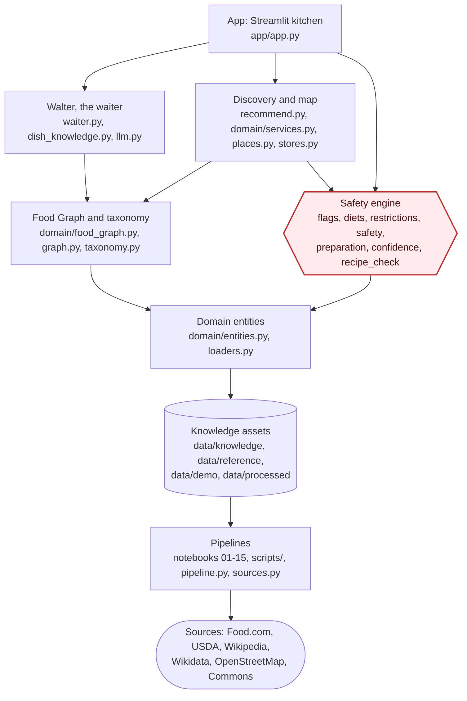

# Architecture

How EverFlavor fits together today: a hybrid of data pipelines, a culinary knowledge graph, a safety engine,
discovery and a Streamlit app. Each layer only reads the layers below it; safety decisions come from the safety
layer and nothing above it changes them.

| Layer | What it does | Where | Page |
|---|---|---|---|
| App | The kitchens, search, recipe cards, dish page, Check my recipe, the map | `app/` | [app/README.md](../../app/README.md) |
| Walter | Tells a dish's story and explains its flags from sourced notes; local models through Ollama | `waiter.py`, `dish_knowledge.py`, `llm.py`, `crew.py`, `agent_tools.py` | [src/everflavor/README.md](../../src/everflavor/README.md) |
| Discovery and map | Recommendations, related dishes, places that sell a cuisine | `recommend.py`, `domain/services.py`, `places.py`, `stores.py` | [src/everflavor/README.md](../../src/everflavor/README.md) |
| Safety engine | Decides, in plain code, which allergy, diet or screen a recipe breaks, how serious and how sure | `flags.py` ... `recommend.passes_safety_filter` | [safety_engine.md](safety_engine.md) |
| Food Graph and taxonomy | Places, dish families, dishes, versions and recipes as one graph, each edge with its evidence | `domain/food_graph.py`, `domain/graph.py`, `taxonomy.py` | [domain/README.md](../../src/everflavor/domain/README.md) |
| Domain entities | `Dish`, `Recipe`, `Ingredient`, `Place`: one owner per fact | `domain/entities.py`, `domain/loaders.py` | [domain/README.md](../../src/everflavor/domain/README.md) |
| Knowledge assets | The committed tables and facts, each with its source and licence | `data/` | [data/README.md](../../data/README.md) |
| Pipelines | Download, clean, flag, link and audit | `notebooks/`, `scripts/` | [notebooks/README.md](../../notebooks/README.md) |

**How coverage is measured:** representation per country, not dish count
([world_culinary_coverage.md](../audits/world_culinary_coverage.md)).

**The original agent design** (Nutritionist, Chef and Sourcing agents with a safety filter between them) is in the
main README's Architecture section; `crew.py` and the safety gate carry it today.
